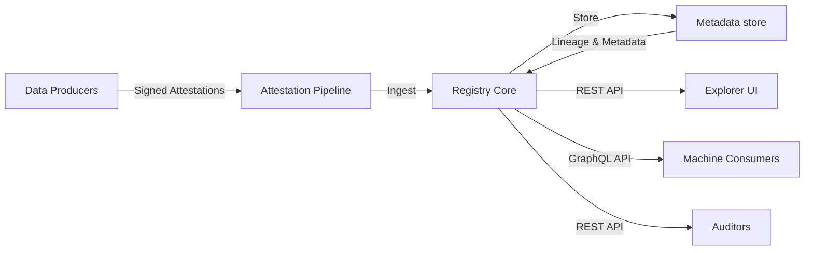
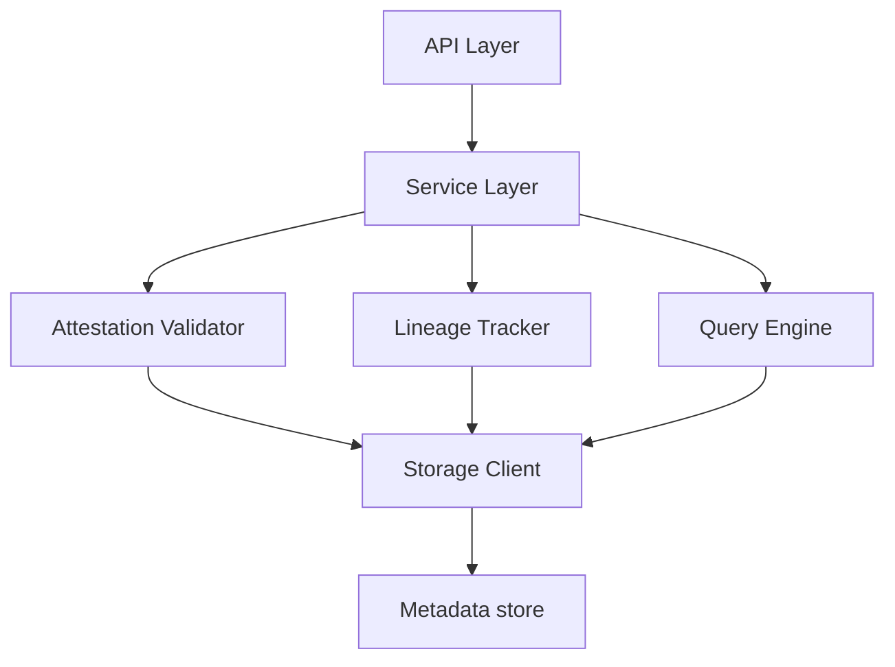

Title: Registry
license: https://www.apache.org/licenses/LICENSE-2.0

The Apache Sourcelume Registry is the central repository for signed provenance records.
It provides a stable, queryable endpoint for dataset consumers and auditors to
verify provenance claims.

## Current Implementation vs. Target Architecture

The Registry is evolving. The current implementation is a Quarkus service that validates,
stores, and resolves provenance records through a REST API. Storage is pluggable through a
storage SPI: the **PostgreSQL distribution** is the default backend, and an **Apache Atlas
distribution** is also available. The high-level architecture below describes the target
enterprise-grade system, and the **[Simple Demo](https://github.com/apache/sourcelume-registry/tree/main/examples/simple-demo)**
remains a lightweight way to try the core registry workflows without a real backend.

## Quick Start: Simple Demo

Want to see the registry in action without any infrastructure? The `simple-demo` provides a lightweight, standalone implementation of the core registry concepts.

- **Purpose**: Demonstrates the fundamental REST API workflows for provenance.
- **Ideal for**: Rapid prototyping, understanding basic data flow, and local testing.
- **Key Difference**: Uses an in-memory store instead of a persistent backend.

**[View the Simple Demo on GitHub →](https://github.com/apache/sourcelume-registry/tree/main/examples/simple-demo)**

To see the whole stack — training a small model and publishing its provenance records —
visit the [Sample](sample.html).

---

## API Reference

The REST API of the current registry implementation is described by an OpenAPI document that
is kept in sync with the code:

- **[OpenAPI document (`docs/openapi.yaml`)](https://github.com/apache/sourcelume-registry/blob/main/docs/openapi.yaml)**
  — the endpoints, request and response schemas, and status codes of the `main` branch.
- **Interactive documentation** — a locally running registry serves the same document at
  `/q/openapi` and an interactive Swagger UI at `/q/swagger-ui`
  (for example `http://localhost:8082/q/swagger-ui`).

The API is still evolving. The *API Design* section below sketches the intended design of
the registry; the OpenAPI document describes what the registry implements today.

---

## High-Level Architecture (Target State)

The Registry serves as the authoritative store for AI training data provenance records. It receives signed attestations from data producers, stores them with full lineage tracking, and exposes them through modern APIs for verification and audit.



**Architecture Flow:**

1. **Data Producers** → Signed Attestations → **Attestation Pipeline**
2. **Attestation Pipeline** → Ingest → **Registry Core**
3. **Registry Core** ↔ Store/Retrieve ↔ **Metadata store**
4. **Registry Core** → REST API → **Explorer UI**
5. **Registry Core** → GraphQL API → **Machine Consumers**
6. **Registry Core** → REST API → **Auditors**

**Key Components:**

- **Metadata store** — Pluggable through the storage SPI; PostgreSQL is the default distribution today, and the Apache Atlas distribution adds lineage tracking and graph-based querying
- **Attestation Ingestion** — Validates and processes signed provenance records
- **REST & GraphQL APIs** — Dual interface for human-readable exploration and programmatic access
- **Verification Engine** — Cryptographic signature validation and chain-of-custody verification

## Detailed Architecture

### Technology Stack

The Registry is built with:

- **Java 21** — Modern Java with performance improvements and language features
- **CDI (Contexts and Dependency Injection)** — Enterprise dependency injection and lifecycle management
- **Storage SPI** — Pluggable metadata backends; PostgreSQL (default distribution) and Apache Atlas
- **REST & GraphQL** — Dual API layer for flexible access patterns

### Core Modules



The Registry architecture consists of several layered modules:

- **API Layer** — REST and GraphQL endpoints with authentication and rate limiting
- **Service Layer** — Business logic that coordinates attestation processing, verification, and querying
- **Attestation Validator** — Cryptographic signature verification and schema validation
- **Lineage Tracker** — Manages provenance chains and dataset relationships in the metadata store
- **Query Engine** — Optimized queries against the metadata store for common access patterns
- **Storage Client** — Integration layer with the pluggable storage backend
- **Metadata store** — Underlying repository for records and lineage (PostgreSQL or Apache Atlas today)

### Data Flow

1. **Ingestion Workflow**
   - Attestation arrives via REST endpoint with signature
   - Signature validated against known public keys
   - Schema validated against Sourcelume specification
   - Metadata extracted and normalized
   - Record stored in the metadata store with lineage relationships
   - Confirmation returned to producer

2. **Query Workflow**
   - Consumer requests provenance for dataset identifier
   - Query engine translates to a store-specific lineage query
   - Results filtered and formatted
   - Signature proofs included in response
   - Response returned via REST or GraphQL

3. **Verification Workflow**
   - Auditor submits attestation for verification
   - Registry checks signature validity
   - Lineage chain reconstructed from the metadata store
   - Chain-of-custody validated
   - Verification report generated

### API Design

**REST Endpoints:**

- `POST /api/v1/attestations` — Submit new attestation
- `GET /api/v1/attestations/{id}` — Retrieve attestation by ID
- `GET /api/v1/datasets/{id}/provenance` — Get full provenance chain
- `POST /api/v1/verify` — Verify attestation signature and chain

**GraphQL Schema:**

```graphql
type Attestation {
  id: ID!
  datasetId: String!
  producer: Producer!
  signature: Signature!
  metadata: JSON!
  lineage: [Attestation!]!
}

type Query {
  attestation(id: ID!): Attestation
  datasetProvenance(datasetId: String!): [Attestation!]!
  verifyAttestation(attestationId: ID!): VerificationResult!
}
```

## Developer Setup

To contribute to the Registry or run it locally for testing, follow these steps.

### Prerequisites

- **Java 21** — Install via [SDKMAN!](https://sdkman.io/) or your package manager

```bash
  sdk install java 21.0.1-tem
```

- **Maven** — Build tool
- **Docker** — For running the storage backend locally
- **Git** — Version control

### Local Development Environment

1. **Clone the repository**

```bash
   git clone https://github.com/apache/sourcelume-registry.git
   cd sourcelume-registry
```

2. **Start a storage backend**

   The `dev-support` directory contains Docker Compose files for the supported backends.
   For the default PostgreSQL distribution:

```bash
   docker compose -f dev-support/docker-compose.postgres.yml up -d --wait
```

   For the Apache Atlas distribution, start a local Atlas 2.5.0 stack instead (Atlas
   runs on `localhost:21000`, default credentials `admin` / `atlasR0cks!`).

3. **Build the project**

```bash
   mvn clean install
```

4. **Run the Registry**

   The repository ships two distributions — one per storage plugin:

```bash
   mvn -pl sourcelume-registry-distribution-postgres quarkus:dev
   # or
   mvn -pl sourcelume-registry-distribution-atlas quarkus:dev
```

   The Registry API will be available at `http://localhost:8082`, with OpenAPI at
   `/q/openapi`, Swagger UI at `/q/swagger-ui`, and health at `/q/health/ready`.

   See
   [`dev-support/README.md`](https://github.com/apache/sourcelume-registry/blob/main/dev-support/README.md)
   for the full matrix of backend and distribution combinations.

### Testing Against Local Registry

The `dev-support` directory includes Docker Compose configurations for the supported storage backends.

**Run integration tests:**

```bash
mvn verify -Pintegration-tests -pl sourcelume-registry-distribution-atlas
```

**Publish a record:**

```bash
curl -X POST http://localhost:8082/records \
  -H "Content-Type: application/ld+json" \
  --data-binary @examples/simple-demo/sample-provenance-record.jsonld
```

**Read it back (references resolved on read):**

```bash
curl http://localhost:8082/records/<url-encoded-record-id>
```

**Query the dataset views:**

```bash
curl "http://localhost:8082/api/v1/datasets?qualifiedName=<record-id>"
```

### Development Tips

- **Hot Reload** — `quarkus:dev` reloads Java changes automatically in dev mode
- **Atlas UI** — When using the Atlas distribution, `http://localhost:21000` exposes the Atlas UI for browsing metadata and lineage
- **Logging** — Set `quarkus.log.level=DEBUG` for verbose output during development

## Registry Repository

The Sourcelume Registry is actively developed in its own repository:

- **[apache/sourcelume-registry](https://github.com/apache/sourcelume-registry)**

Visit the repository to:

- View current implementation status
- Report issues or propose features
- Contribute code or documentation
- Join technical discussions
